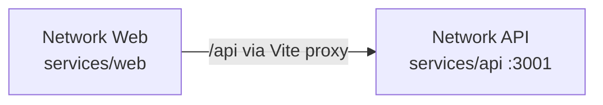

# Azure Debug Plan

> This plan is the source of truth for generating the
> VS Code debug setup in this workspace.
>
> **Status:** Planning
> **Execution Mode:** Guided
> **Created:** 2026-10-03T13:00:50+05:30
> **Last Updated:** 2026-10-03T13:00:50+05:30
>
> Review the selected debug targets and approve this plan before configuration files are generated.

---

## Prerequisites

| Tool / Extension | Category | Service(s) | Installed | Version |
|------------------|----------|------------|-----------|---------|
| Node.js | Runtime | api, web | ✅ | 24.14.0 |
| npm | Package manager | api, web | ✅ | 11.9.0 |
| Microsoft Edge | Browser | web | ✅ | 154.0.4258.48 |
| ms-vscode.js-debug | VS Code extension | api, web | ✅ | 1.140.0 |
| Python | Runtime | tkinter-prototype | ✅ | 3.13.7 |
| ms-python.python | VS Code extension | tkinter-prototype | ✅ | 2026.6.0 |

---

## Debug Configurations

No `launch.json` or `tasks.json` exists yet. The existing `.vscode/settings.json` will be preserved.

| Generate | Debug Config Name | Service Label | Service Root | Project Type | Runtime | Version | Azure Dependencies |
|----------|--------------------|---------------|--------------|--------------|---------|---------|---------------------|
| [x] | Network API (debug) | Network API | ./services/api | app-service | node-js | 24.14.0 | — |
| [x] | Network Web (debug) | Network Web | ./services/web | frontend-spa | node-ts | 24.14.0 | — |
| [ ] | Tkinter Prototype (debug) | Tkinter Prototype | ./pp.py | desktop-app | python | 3.13.7 | — |
| [x] | Debug All Services | Debug All Services | — | *Compound Config* | — | — | — |

The web app's Vite proxy targets `http://localhost:3001`, so the compound configuration should start Network API before Network Web. The Tkinter prototype is a separate existing app and is intentionally excluded from the default compound launch.

Project Type Descriptions

| Project Type | Description |
|-------------|-------------|
| app-service | Express HTTP API started by the existing npm `dev` script. |
| frontend-spa | Vite-hosted React and TypeScript single-page application. |
| desktop-app | Standalone Python Tkinter application. |

---

## Orchestrator

No Azure SDK or database dependencies were detected, so local emulator containers are not required for this project.

| Orchestrator | Container Runtime | Compose Command | Description |
|-------------|-------------------|-----------------|-------------|
| Not required | — | — | No emulator-backed Azure dependencies were found. |

---

## Emulators

No emulators are required.

---

## Architecture Diagram

The Vite development server serves the web app and forwards `/api` requests to the local Express API on port 3001.

---

## API Test Collections

| Generate | Service | Description |
|----------|---------|-------------|
| [x] | Network API | 

HTTP Endpoints (3)
 GET /api/health GET /api/network-overview GET /api/impact?serverName=Router1  Also verify GET /api/impact without `serverName` returns 400 and an unknown server returns 404.
 |

---

## Convenience Scripts

No additional package scripts are proposed. The debug configurations will use the existing API and web `dev` scripts; the web package also provides `build` and `lint` scripts.

---

## Notes

- The web package manifest has no test script or Vitest dependency, despite Vitest being listed in `.azure/project-plan.md`. API smoke tests are included here, but automated unit tests will need to be configured separately.
- No Azure SDK packages, database dependencies, or migration files were detected.
- Docker and Podman are not prerequisites for the currently detected services because no emulator-backed Azure dependencies are present.